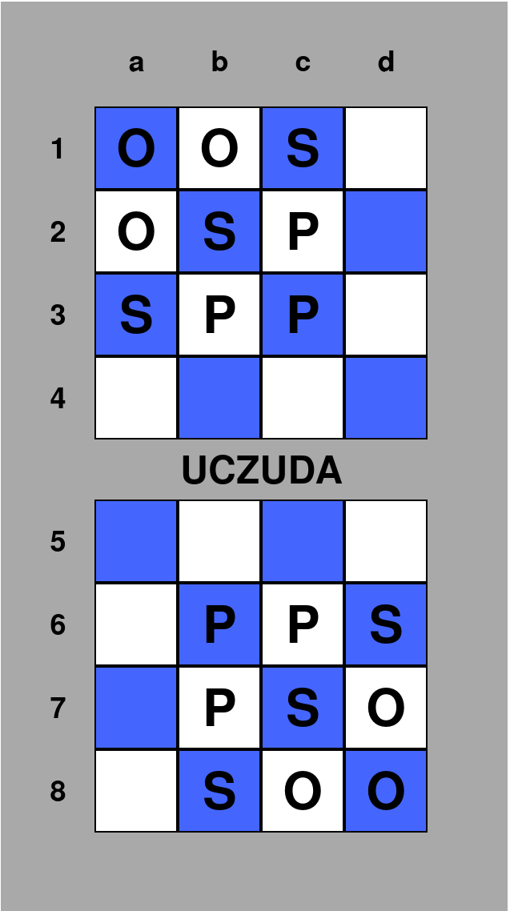
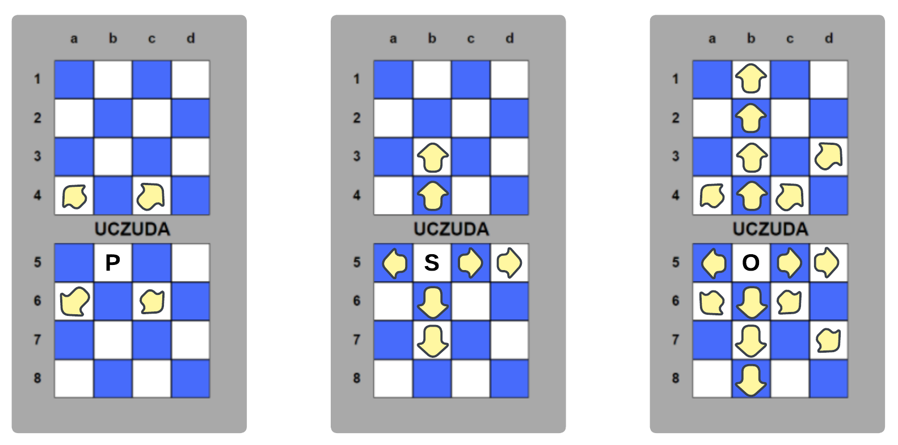
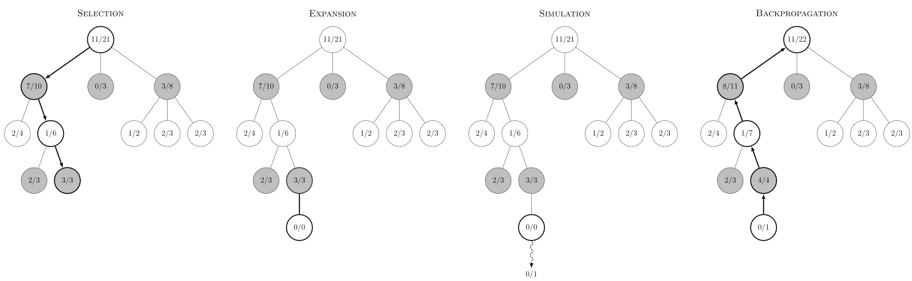

# RLZilatran

This project uses poetry for managing dependencies for Python 3.10. To use use the environment run
```bash
poetry install
poetry env activate
```

To install pre-commit hooks use
```bash
poetry run pre-commit install --hook-type pre-commit --hook-type commit-msg
```

To run tests:
```bash
poetry run pytest
```

To get test coverage:
```bash
poetry run coverage run -m pytest
```
and for the interactive html:
```bash
poetry run coverage html
```

## Zilatran Chess

The Goal of this project is to apply Reinforcement Learning approaches to [Zilatran Chess]() to generate a Program able to play the game.

[Zilatran Chess]() is a grid based board game where the objective of the game is to not run out of pieces to play with while attempting to capture pieces of more than half of the total value available on the board.

The game is played on a 4x8 board where each player controls all pieces on one 4x4 side of the board. This implies that moving a piece to the other/opponents side of the board relieves the players control over said piece.

Each player starts with 3 Privates $P$, 2 Sergeants $S$ and 3 Officers $O$ with capture value 1, 2 and 3 respectively. The starting position is shown below on the far left. Each of the three different pieces has different move possibilites as shown in the 3 rightmost images:




[Source](https://www.zilatranchess.com/gamehomepage.html)

A capture of a piece needs to happen on the opponents side of the board, meaning a piece needs to switch control to the opponent breaking common conceptions gathered from playing chess, making the game quite unique in playstyle.

## Basics

The approach seeks to mimic the principles of [AlphaZero](https://arxiv.org/abs/1712.01815). This implies using a [Convolutional Neural Network (CNN)]() to provide a policy estimate, which itself is trained through self-play using [Monte Carlo Tree Search (MCTS)]() as a basis to improve policy.

### Convolutional Neural Network

Ideally the policy could hold an exact Value estimate $V(s, a)$ for each state action pair. Since the number of such pairs far exceeds reasonable computational resources we seek a different way to generate such an estimate for state action pairs.

CNNs have shown the ability to combinde global understanding of game states with local details as demonstrated by [AlphaGo Zero](https://deepmind.google/discover/blog/alphago-zero-starting-from-scratch/) and later [AlphaZero](https://arxiv.org/abs/1712.01815). These should therefore offer great performance in this application.

Since a wide variety of CNNs have been utilized, it would be reasonable to replicate a Net already proven for this game, adapting only if needed. Starting with a low weight CNN for testing and development should speed up prototyping, finally competitive training could use RESNet matching the [AlphaZero]() approach.

Generally the game state could be represented as a $(4, 8, 6)$ types to separate pieces and players into layers. This serves as the input to the CNN which outputs a value rating $v(s)$ from $\left[-1, 1 \right]$ for the current game state $s$ and a propability vector $\vec p(s)$ over the possible moves from the current state.

The loss function is given by:

$$l = \sum_{t} (v_{\theta}(s_{t}) - z_{t})^2 - \pi_{t} \cdot \log(p_{\theta}(s_{t}))$$

where $\pi_{t}$ is the estimate of the state through an outside estimator such as described in the coming chapter.

The network itself takes a 4x8x52 input and retrieves a propability distribuion over a 4x8x41 and a position value estimate. The Input size is governed by the state representation of the pieces three pieces for each player on the 4x8 board making a single state representation 4x8x6. Eight previous states are also passed to the CNN with additional channels for:
    - player to move
    - captured value
    - move since last capture
    - move since repetition call
This leads to the total channel number: $6 \cdot 8 + 4 = 52$

The output tensor size is determined by the need to keep its size constant (from a technical standpoint as CNN output is constant in size). Therefore we need a channel for all moves a piece could make from each position. Invalid moves can be masked out later. The consideration therefore is that Officers cover all moves by all pieces, creating up to 40 theoretically possible move targets:
    - 2 straight move directions contribute 7 (one less than board length) targets each
    - diagonal move directions contribute 3 (one less than board width) targets each
    - a player can call a capture after 7 non capture moves that ends game after 7 more moves without capture
For 4 straight and 4 diagonal directions we get: $4 \dot 3 + 4 \cdot 7 + 1 = 41$

The position value will be represented by a second head of the neural network outputting simply a floating point estimate of the position value.

### Monte Carlo Tree Search

To train the CNN we need to generate reference Value estimates, where we have a wide variety of choices. To stick to the model of [AlphaZero](https://arxiv.org/abs/1712.01815) the clear choice would presented by the Monte Carlo Tree Search algorithm ([SARSA/Q-Learning](https://en.wikipedia.org/wiki/Q-learning) or [first/every visit MC](https://www.andrew.cmu.edu/course/10-403/slides/S19_lecture4_MC.pdf) methods could have been employed but the paralellization of MCTS seems most interesting).

The priniciple of MCTS relies on the fact that the value of taking action $a^i_n$ from state $s_n$ strictly relies on the value of the next state (if s_n is not terminal) and the possible actions from there. In this case the upper index implies choice $i$ from the list of possible actions from the state $s_n$ where $n$ refers to the search depth of said state compared to the currently existing game state $s_0$. We can therefore derive an estimate of the state action pair by searching the tree of possible following states. Since an exhaustive search itself rather unfortunately scales exponentially with the number of possible actions per state, we have to compromise and select only certain pathways to analyse.

But how can we possibly choose these tree branches? On the one hand we could make a  uniform random choice by choosing an action according to the policy $\pi$, where $\#a(s_n)$ represents the number of possible actions:

$$\pi(s_n,a_n^i) = \frac{1}{\#a(s_n)}$$

This would give us a clear estimate but would imply calculating large parts of the tree which might be effectively lost after even the first or more generally early moves (returning essentially to an off policy method). On the other hand we might simply always greedily chose the state action pair with the greatest expected return available at each searched state implying the policy $\pi$:

$$\pi(s_n,a_n^i) = max\left(Q(s_n, a_n^i)\right)$$

The issue with this approach is that the improvement will be heavily limited as the algorithm will not explore other options. This is problematic since the initial esimates the CNN makes might be far from the ideal estimates $Q*(s, a)$, leading the algorithm to heavily stagnate in one way of play not converging to the ideal policy $\pi*$.

We could simply design a so called epsilon-greedy policy that deviates from the greedy choice with the small constant propability $\varepsilon$, uniformely choosing amongst the other actions. This however might not balance the tradeoff between exploration and exploitation consistently as the valuation of different moves might not be as clear cut: If there are for example two similarily strong moves it will not reflect this in the choice.

The obvious choice is then to simply take the valuations of the current policy to make a weighted selection according to the current policy ingrained in the CNN. This allows for exploration of actions with non optimal outcomes while still taking their current value into account.

Using this algorithm iteratively sweeping over the state action tree can be achieved until the termination criteria are met (i. e. usually time limit) as seen below. Generally to keep memory low only a limited number of new leaves are explored when encountering new ground. This means the depth of the branch is usually only expanded by 1.



[Source](https://commons.wikimedia.org/wiki/File:MCTS-steps.svg)

Then the corresponding Values can be backpropagated to the previous nodes to gain a training target (visualized by the returning arrows).

$$U(s,a) = Q(s,a) + c \sqrt{\frac{\ln \left( N(s) \right)}{N(s,a)}}$$

Where:
 - $Q(s, a)$: Expected return of said state actiuon pair
 - $N(s, a)$: Number of times taking $a$ from $s$
 - $N(s)$: Number of visits to $s$

Repeating this procedure slowly builds out a tree and generates better valuation of states.

### HPC Methods and Resources

Monte Carlo tree search itself offers different pathways to distributed memory parallelization:
- Leaf-Level parallelization: Different branches can be evaluated largely independently, as the backpropagation only needs to happen near the end of evaluation. Generally more complex to implement and generates more communication overhead.
- Root parallelization: Running different Monte Carlo Trees in parallel and combining at the end of all evaluations reduces difficulties in the implementation compared to leaf parallelization. Reduces Communication overhead.
The approach would be to use MPI paralellization through the mpi4py package.

The Training and Evaluation of the CNNs is strongly preferred on the GPU. While Multi GPU architecture could be leveraged it should not prove necessary, since the Networks themselves are comparitively small and low effort to evaluate. Here pytorch would be utilized to rely on existing implementations of CNN, Training and Evaluation.

In case the option exists batch training could provide further advantages especially for multi gpu/node utilization.

The goal is to allow for asynchronous generation of Monte Carlo estimates while the CNN`s weights are updated at the same time on the GPU to utilize both at the same time.

While access to the Leo5 cluster could prove usefull, there exists the preference to work on a private old Workstation with a dual CPU setup with 28 hyperthreaded cores  (Intel E3-2695V3) with access to 2 GPUs (Nvidia RTX A2000). This is due to the long waiting times on the Leo5 cluster which could make the performance difference negligable.
